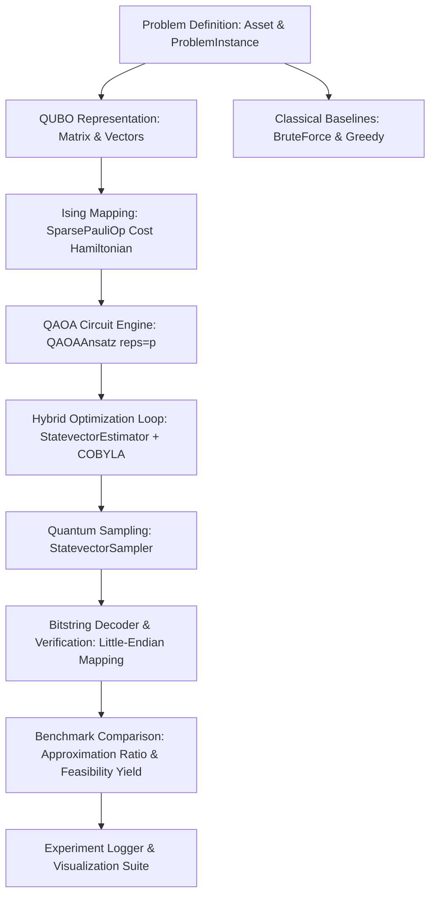

# System Architecture & Technical Design

This document details the software architecture, design patterns, module responsibilities, and data flows of the **Quantum Resource Optimizer**.

---

## 1. Architectural Overview

The repository is structured into modular Python components that decouple problem specification, classical benchmark algorithms, quantum Hamiltonian construction, QAOA circuit orchestration, execution/evaluation, and visual reporting.

---

## 2. Component Structure

### 2.1. Problem Layer (`src/quantum_optimizer/problem.py`)
- **`Asset`**: Immutable dataclass encapsulating renewable project metadata (name, category, capacity/yield, carbon offset rating).
- **`ProblemInstance`**: Mathematical container for returns vector $r \in \mathbb{R}^n$, covariance matrix $\Sigma \in \mathbb{R}^{n \times n}$, budget target $B$, risk factor $q$, and penalty weight $\lambda$.
- **Validation Engine**: Guarantees matrix symmetry, dimension compatibility, positive penalty multipliers, and non-trivial budget ranges.
- **Evaluation Logic**: Direct evaluation of true Markowitz utility $\mathcal{U}(x)$, quadratic constraint violation penalty, and unconstrained cost $C(x)$.

### 2.2. Classical Baselines Layer (`src/quantum_optimizer/classical_solvers.py`)
- **`BruteForceSolver`**: Evaluates all $2^n$ bitstrings in $\mathcal{O}(2^n)$ time to establish the provable ground truth $x^*$, optimal utility $\mathcal{U}^*$, and count of feasible assignments $\binom{n}{B}$.
- **`GreedySolver`**: Fast $\mathcal{O}(n \log n)$ classical heuristic ranking projects by risk-adjusted return ($r_i / \sqrt{\Sigma_{ii}}$) and taking the top $B$ candidates.

### 2.3. Quantum Hamiltonian Layer (`src/quantum_optimizer/hamiltonian.py`)
- **`build_qubo_matrix`**: Translates utility and constraint penalty terms into upper-triangular QUBO coefficients ($Q_{ij}$ for $i < j$, $Q_{ii}$ for linear terms, and scalar offset $\lambda B^2$).
- **`build_cost_hamiltonian`**: Executes the affine mapping $x_i = \frac{I - Z_i}{2}$ to generate two-qubit $ZZ$ couplings $J_{ij}$ and single-qubit $Z$ fields $h_i$. Produces a simplified `qiskit.quantum_info.SparsePauliOp`.
- **`verify_hamiltonian_ground_state`**: Automatically verifies diagonal expectation value equivalence $\langle x | \hat{H}_C | x \rangle == C(x)$ for all computational basis states.

### 2.4. QAOA Solver Layer (`src/quantum_optimizer/qaoa_solver.py`)
- **`QAOAAnsatz`**: Employs Qiskit 1.0+ / 2.0+ standard library circuit class with alternating cost $e^{-i \gamma H_C}$ and transverse mixer $e^{-i \beta \sum X_i}$ unitaries.
- **`StatevectorEstimator`**: Hybrid classical parameter tuning using `scipy.optimize.minimize` (COBYLA algorithm) without shot noise to find optimal variational angles $(\vec{\gamma}^*, \vec{\beta}^*)$.
- **`StatevectorSampler`**: Simulates projective measurements in the computational basis across 4096 shots.
- **`key_to_assignment`**: Corrects Qiskit's little-endian bitstring convention ($q_0$ rightmost) into natural asset indexing ($x_0$ index 0).
- **Metric Analytics**: Measures Approximation Ratio $\alpha = \mathcal{U}(x_{\text{QAOA}}) / \mathcal{U}(x_{\text{opt}})$ and Feasibility Yield $Y_{\text{feas}} = N_{\text{feasible}} / N_{\text{shots}}$.

### 2.5. Experiment & Visualization Layer (`src/quantum_optimizer/experiment_runner.py` & `visualization.py`)
- Systematic sweep execution across circuit depths $p \in \{1, 2, 3\}$ and constraint penalty multipliers $\lambda \in [0.5, 5.0]$.
- Standardized run output structure (`outputs/runs/YYYYMMDD_HHMMSS_...`) with JSON metadata and CSV tabular summaries.
- High-resolution Matplotlib figures documenting energy convergence, sampled bitstring distributions, and scaling tradeoffs.

---

## 3. Data Flow and Invariants

1. **Precision & Determinism:** Random number generators are seeded with fixed seeds (`seed=42`) across problem generation, parameter initialization, and sampler shots to guarantee 100% test reproducibility.
2. **Offline Local Execution:** The entire stack operates strictly locally using statevector primitives, requiring zero cloud tokens or external network calls.
3. **Traceability:** Every sampled quantum bitstring is independently re-scored by the classical `ProblemInstance` to verify whether it meets the budget constraint and compute its exact physical utility score.
